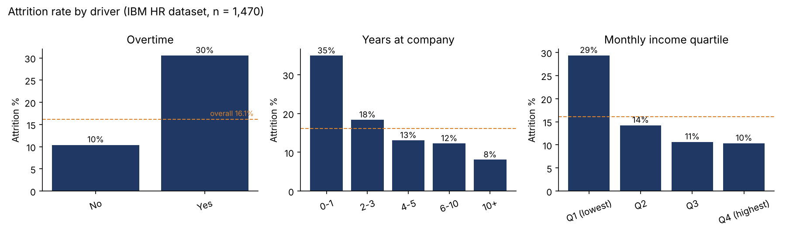
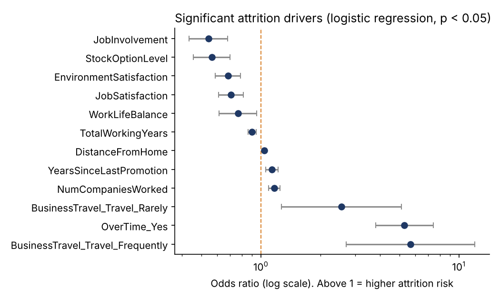

# Attrition risk model

**Question:** which employees are most likely to leave in the next year, and what drives it?

**Data:** IBM HR Analytics Employee Attrition dataset. Fictional, 1,470 employees, 16.1% attrition.

## Results

| | Result |
|---|---|
| Model | Logistic regression, cross-validated ROC AUC 0.82 (gradient boosting 0.81, so the simpler model was kept) |
| Risk list | The top 20% risk scores catch 60% of the people who actually left. 49% of the flagged employees left, against a base rate of 16%. |
| Biggest drivers | Overtime (odds ratio 5.3), frequent business travel (5.7), years since last promotion, number of previous employers |
| Protective factors | Job involvement, stock options, environment and job satisfaction, work-life balance |
| Fairness check | Women 21% flagged / 64% of leavers caught; men 19% flagged / 58% caught. Close enough that no group is singled out. |

Three groups stand out. Employees doing overtime leave at 30% against 10% for the rest. First-year employees leave at 35%. The lowest income quartile leaves at 29%.

If overtime staff left at the same rate as everyone else, about 84 of the 237 leavers would have stayed. That is a description of the data, not proof that cutting overtime would keep them. A pilot with a comparison group would be the next step.

## What I would do with this in a real company

- Share the driver analysis (overtime, promotion gaps, first-year experience) with HR Business Partners. Keep the individual risk scores out of general reporting.
- Use the risk list only for supportive stay conversations, agreed with the works council, never for performance or redundancy decisions.
- Re-run quarterly and track whether attrition in the flagged groups changes.

## Method

1. Attrition rate by overtime, tenure, income, job level and department.
2. Features: all job, pay and satisfaction fields. Gender, marital status and age are left out on purpose.
3. Logistic regression and gradient boosting, 5-fold stratified cross-validation, ROC AUC.
4. Odds ratios with 95% confidence intervals from a statsmodels logit on 13 key drivers.
5. Fairness check: share flagged and share of leavers caught, by gender.

Full tables: [results.md](results.md). Code: [attrition_model.py](attrition_model.py).
