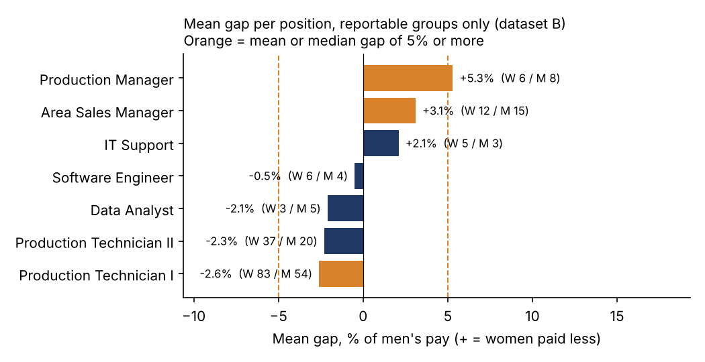

# Pay equity analysis (EU Pay Transparency Directive)

**Question:** is there a gender pay gap, overall and within each category of workers, and is it explained by gender-neutral factors?

The EU Pay Transparency Directive (2023/970) asks employers to report the gender pay gap overall and per category of workers. If a category shows a gap of 5% or more that objective, gender-neutral factors do not explain, the employer has to run a joint pay assessment with employee representatives. This project runs that check on two fictional datasets.

## Results

| | Dataset A: IBM HR (1,470) | Dataset B: Huebner HR (311) |
|---|---|---|
| Unadjusted gap, mean / median | -4.8% / -5.0% (women paid more) | 4.0% / 2.0% |
| Adjusted gap (same level or position, experience, tenure, rating) | -0.3% (95% CI -2.6% to +2.0%) | +0.4% (95% CI -2.1% to +3.0%) |
| Categories at 5% or more | none of 5 job levels | 3 positions: Production Manager, Area Sales Manager, Production Technician I |
| Categories too small to report | 0 of 5 | 24 of 31 positions |

What this shows:

- In both datasets the overall gap disappears once you compare like with like. The unadjusted gap in dataset B comes from where women and men work, not from different pay for the same job.
- Dataset B still has three positions at or above 5%. Under the directive each needs either an objective, gender-neutral reason or a joint pay assessment. In Production Technician I the gap goes the other way (women's median is 5.5% higher), which also counts.
- 24 of 31 positions have fewer than 3 women or 3 men. Reporting them would expose individual salaries. A company needs an agreed minimum group size and a sensible definition of "work of equal value" before the first report, not after.

## Method

1. Gap = (men's pay - women's pay) / men's pay, for mean and median.
2. Category of workers: job level (A) and position (B). Position names are cleaned first ("Data Analyst " and "Data Analyst" are one job).
3. Adjusted gap: OLS on log pay with gender plus gender-neutral controls, robust standard errors.
4. Categories with fewer than 3 women or 3 men are suppressed.

Full tables: [results.md](results.md). Code: [pay_equity.py](pay_equity.py).

Limits: fictional data, one pay field (no bonus or benefits), and no job evaluation scheme, so "work of equal value" is approximated by level or position.
